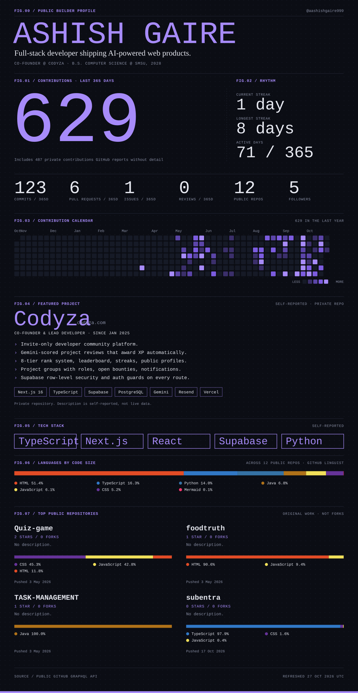

<picture>
  <source media="(prefers-color-scheme: dark)" srcset="./assets/profile-dark.svg" />
  <source media="(prefers-color-scheme: light)" srcset="./assets/profile-light.svg" />
  
</picture>

[codyza.com](https://codyza.com) · [Email](mailto:gaireashish64@gmail.com) · [All repositories](https://github.com/aashishgaire999?tab=repositories)

Open to internships and co-op roles · B.S. Computer Science @ Southwest Minnesota State University, expected May 2028

Stats are pulled from the public GitHub API every 6 hours by <a href="./.github/workflows/update-profile.yml">this workflow</a>. Nothing on the card is typed in by hand except the parts labeled self-reported.
